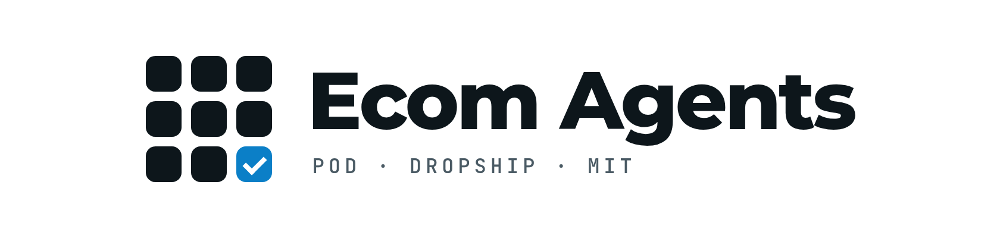
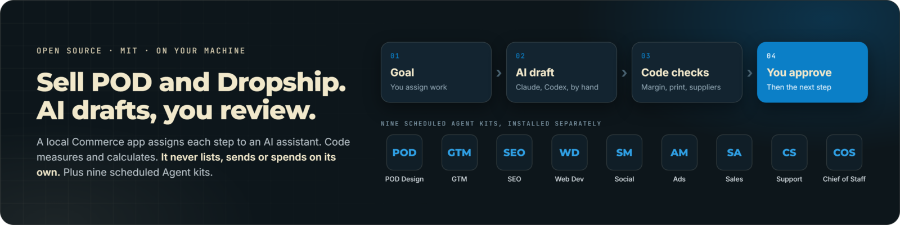

<p align="right"><strong>English</strong> · <a href="README.vi.md">Tiếng Việt</a></p>

<h1 align="center">
  <picture>
    <source media="(prefers-color-scheme: dark)" srcset="assets/logo-dark.png">
    
  </picture>
</h1>

<p align="center"></p>

Open source AI tools for one person running a **POD (print on demand)** or **Dropship** shop. Two independent parts live in this repository:

- **Local Commerce app**: research products, prepare designs, check data, calculate margin, and draft selling copy. You assign work, AI prepares the file, you review and approve each step.
- **Nine scheduled Agent kits**: each kit owns one job, installs on your machine, and runs at a fixed time.

The app does not list products, place orders, send messages, or spend ad money on its own. Kits follow the same rule: an outbound action completes only on a channel you opened in `RELEASES.md`.

This is a public MIT repository. Use it, fork it, and run it locally. There is no hosted SaaS and no paid product tier in this checkout.

## Start the app

Install Node.js 22 or newer. Clone or download the ZIP, open a terminal in the folder that contains `package.json`, then run:

```sh
git clone https://github.com/dh2211/ecom-agents-public.git
cd ecom-agents-public
npm start
```

On Windows you can double-click `START-WINDOWS.cmd`. You do not need `npm install`, `hire`, or a profile to use the app. Keep the terminal open while you work.

Click **Try the demo without AI** to learn the loop. Demo data is simulated. It is not a product file you should sell.

## Two main app workflows

| Model | Work |
|---|---|
| POD | Niche → design brief → real printer PNG checks → margin → listing draft → launch copy set. |
| Dropship | Product → supplier, sample, and shipping checks → margin → listing draft → creative → test proposal. |

The Creative workflow is shared: prepare UGC or banners and check real export files. Scripts are not video. The app does not ship an image, video, or voice service. Measuring or assembling media needs FFmpeg and ffprobe on the machine.

## Nine scheduled Agent kits

Install kits one at a time. They are optional for the app. Each kit is a folder of routines that fire on a schedule and write files for you to review:

| Kit | Owns |
|---|---|
| GTM Engineer | Product research and launch |
| SEO/AEO Agent | Search and answer presence |
| Web Dev Agent | Site engineering and upkeep |
| Social Media Agent | Audience and content distribution |
| Ad Manager Agent | Paid ads |
| Sales Agent | Pipeline and outreach |
| Customer Satisfaction Agent | Support and retention |
| Chief of Staff | Oversight of the other agents |
| POD Design Agent | POD print files: niche design skills, checked transparent PNGs, and receipts |

Install a kit from this checkout:

```sh
node installer/cli.mjs hire pod-design-agent --to ~/ecom-agents/pod-design-agent
```

Then open an agent session in that folder and say "install the POD Design Agent from this folder" (or paste `INSTALL-PROMPT.md` from the folder). Every kit follows that path. Step by step detail is in [docs/INSTALL.md](docs/INSTALL.md).

**POD Design Agent** owns print files: drop a request into `requests/inbox/` and the daily `design-request` routine handles it. If the niche has no design skill yet, the kit builds one through the bundled `pod-design-skill-builder`, checks the package against the builder thresholds, commits it to the repository you name, then uses that skill to produce a transparent PNG and run alpha plus print checks on the real file. There is no manual approval loop in skill generation. The kit does not open a browser and does not post anything. You need Node 18+, Python 3.10+, and git. If the image runtime is missing, the request still becomes a held prompt pack. See the [kit README](agents/pod-design-agent/README.md).

## Use your own AI

- **Manual:** copy the request into the assistant you already use, then paste the JSON result into the app.
- **Claude Code:** use an installed, signed-in CLI. Draft only from supplied data. Do not browse the web or generate media on your own.
- **ChatGPT (Codex CLI):** use installed `codex` signed in with a ChatGPT account. Same limits as Claude Code. Useful when a Claude quota is exhausted.
- **Your own worker:** for operators who wire another tool and keep its permissions tight.

No AI subscription is included. Data you send to an assistant may go to that AI provider.

## Guides

- [Full user guide (Vietnamese)](docs/COMMERCE-GUIDE.vi.html): install, choose and install an AI assistant, JSON result samples and data for each check, POD/Dropship/Creative workflows, limits, error-message troubleshooting, glossary, and FAQ. Open it in a browser or click **User guide** in the app.
- [Install and run scheduled kits](docs/INSTALL.md) and [how an Agent works](docs/HOW-AGENTS-WORK.md): kit docs, independent of the app.
- [Advanced POD](docs/POD-ECOMMERCE.md) and [advanced Dropship/Creative](docs/DROPSHIP-CREATIVE.md): standalone skills and scheduled kits. Optional for the app.
- [Architecture and data recovery](docs/COMMERCE-ARCHITECTURE.md).
- [Flock docs map](FLOCK.md): primary documents, plans, and review evidence.

The app is for one person on one machine. Data lives outside the source repo. Check the paths in the UI and back up before you update. Scheduled kits are a separate flow. The app does not move or stop them.

Source is [MIT](LICENSE). Image, video, music, and data rights need their own review. There is no revenue or SLA promise. See [SECURITY.md](SECURITY.md) and [CREDITS.md](CREDITS.md).
