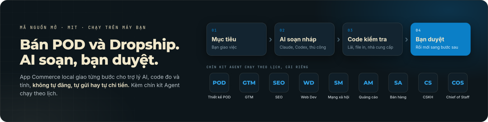

<p align="right"><a href="README.md">English</a> · <strong>Tiếng Việt</strong></p>

<h1 align="center">
  <picture>
    <source media="(prefers-color-scheme: dark)" srcset="assets/logo-dark.png">
    
  </picture>
</h1>

<p align="center"></p>

Bộ công cụ AI mã nguồn mở cho một người vận hành shop **POD (in theo yêu cầu) hoặc Dropship**, gồm hai phần độc lập trong cùng một repository:

- **App Commerce chạy local**: nghiên cứu sản phẩm, chuẩn bị thiết kế, kiểm tra dữ liệu, tính lãi và soạn nội dung bán hàng. Bạn giao việc, AI chuẩn bị hồ sơ, bạn kiểm tra và duyệt từng bước.
- **Chín kit Agent chạy theo lịch**: mỗi kit đảm nhận một vai trò công việc, cài riêng trên máy bạn và chạy vào giờ cố định.

App không tự đăng sản phẩm, đặt hàng, gửi tin hay chi tiền quảng cáo. Kit cũng giữ nguyên tắc đó: hành động ra ngoài chỉ được hoàn tất trên kênh bạn tự mở trong `RELEASES.md`.

Đây là repository public theo giấy phép MIT. Dùng, fork và chạy trên máy bạn. Checkout này không kèm SaaS hay gói sản phẩm trả phí.

## Bắt đầu với app

Cài Node.js 22 trở lên. Clone hoặc tải ZIP của repository, mở terminal tại thư mục có `package.json` rồi chạy:

```sh
git clone https://github.com/dh2211/ecom-agents-public.git
cd ecom-agents-public
npm start
```

Trên Windows có thể nhấp đúp `START-WINDOWS.cmd`. Không cần `npm install`, `hire` hay cài profile để dùng app. Giữ terminal mở khi làm việc.

Bấm **Thử demo không dùng AI** để làm quen. Demo là dữ liệu mô phỏng, không phải hồ sơ sản phẩm dùng để bán.

## Hai quy trình chính trong app

| Mô hình | Công việc |
|---|---|
| POD | Niche → brief thiết kế → kiểm tra PNG thật theo nhà in → tính lãi → listing nháp → bộ nội dung ra mắt. |
| Dropship | Sản phẩm → kiểm tra nhà cung cấp, hàng mẫu và tuyến giao hàng → tính lãi → listing nháp → creative → đề xuất test. |

Workflow Creative dùng chung để chuẩn bị UGC/banner và kiểm tra file xuất thật. Kịch bản chưa phải video; app không kèm dịch vụ tạo ảnh, video hay giọng nói. Công cụ đo/ghép media cần FFmpeg/ffprobe riêng.

## Chín kit Agent chạy theo lịch

Cài riêng từng kit, không bắt buộc để dùng app. Mỗi kit là một thư mục routine chạy vào giờ cố định trên máy bạn và trả kết quả dạng file để bạn duyệt:

| Kit | Đảm nhận |
|---|---|
| GTM Engineer | Nghiên cứu và ra mắt sản phẩm |
| SEO/AEO Agent | Hiện diện trên tìm kiếm và câu trả lời |
| Web Dev Agent | Kỹ thuật và bảo trì web |
| Social Media Agent | Khán giả và phân phối nội dung |
| Ad Manager Agent | Quảng cáo trả phí |
| Sales Agent | Pipeline và tiếp cận khách hàng |
| Customer Satisfaction Agent | Hỗ trợ và giữ chân khách |
| Chief of Staff | Giám sát các agent còn lại |
| POD Design Agent | File in POD: tự tạo skill thiết kế theo niche, PNG trong suốt đã kiểm tra, kèm biên nhận |

Cài một kit từ checkout này:

```sh
node installer/cli.mjs hire pod-design-agent --to ~/ecom-agents/pod-design-agent
```

rồi mở một phiên agent trong thư mục đó và nói "install the POD Design Agent from this folder" (hoặc dán `INSTALL-PROMPT.md` trong thư mục). Kit nào cũng theo quy trình đó; chi tiết từng bước ở [docs/INSTALL.md](docs/INSTALL.md).

**POD Design Agent** đảm nhận file in POD: thả một file yêu cầu vào `requests/inbox/` và routine `design-request` chạy hằng ngày sẽ xử lý. Niche chưa có skill thiết kế thì kit tự tạo một skill qua `pod-design-skill-builder` đi kèm, kiểm tra gói sinh ra theo ngưỡng của builder rồi commit vào repository bạn chỉ định, rồi dùng skill đó để dựng PNG trong suốt và chạy kiểm tra alpha cùng kiểm tra in trên file thật. Không có vòng duyệt tay trong bước sinh skill; kit không mở trình duyệt và không đăng gì ra ngoài. Cần Node 18+, Python 3.10+ và git; thiếu image runtime thì yêu cầu vẫn được xử lý thành gói prompt giữ chờ. Xem [README của kit](agents/pod-design-agent/README.md).

## Dùng AI của bạn

- **Thủ công:** sao chép yêu cầu sang trợ lý bạn đang dùng, rồi dán kết quả JSON vào app.
- **Claude Code:** dùng CLI đã cài và đăng nhập; chỉ soạn từ dữ liệu được cấp, không tự duyệt web hoặc tạo media.
- **ChatGPT (Codex CLI):** dùng `codex` đã cài và đăng nhập bằng tài khoản ChatGPT; cùng giới hạn như Claude Code, dùng được khi hết hạn mức Claude.
- **Worker riêng:** dành cho người kỹ thuật kết nối công cụ khác và giới hạn quyền của nó.

Không bao gồm thuê bao AI. Dữ liệu gửi cho trợ lý có thể đi đến nhà cung cấp AI đó.

## Hướng dẫn

- [Hướng dẫn sử dụng đầy đủ](docs/COMMERCE-GUIDE.vi.html): cài đặt, chọn và cài trợ lý AI, mẫu kết quả JSON và dữ liệu cho từng bước kiểm tra, workflow POD/Dropship/Creative, giới hạn, xử lý lỗi theo thông báo, thuật ngữ và FAQ. Mở bằng trình duyệt hoặc bấm **Hướng dẫn sử dụng** trong app.
- [Cài và vận hành kit theo lịch](docs/INSTALL.md) và [cách một Agent hoạt động](docs/HOW-AGENTS-WORK.md): phần dành cho kit, độc lập với app.
- [POD nâng cao](docs/POD-ECOMMERCE.md) và [Dropship/Creative nâng cao](docs/DROPSHIP-CREATIVE.md): skill độc lập và kit chạy theo lịch, không bắt buộc để dùng app.
- [Kiến trúc và khôi phục dữ liệu](docs/COMMERCE-ARCHITECTURE.md).
- [Bản đồ tài liệu Flock](FLOCK.md): tài liệu chính, kế hoạch và bằng chứng review.

App dành cho một người trên một máy. Dữ liệu nằm ngoài source repo; xem đường dẫn trong giao diện và sao lưu trước khi cập nhật. Kit chạy theo lịch là luồng riêng, không được app tự di chuyển hoặc dừng.

Mã nguồn theo [MIT](LICENSE); quyền sử dụng ảnh, video, nhạc và dữ liệu phải kiểm tra riêng. Không có cam kết doanh thu hoặc SLA. Xem [SECURITY.md](SECURITY.md) và [CREDITS.md](CREDITS.md).
